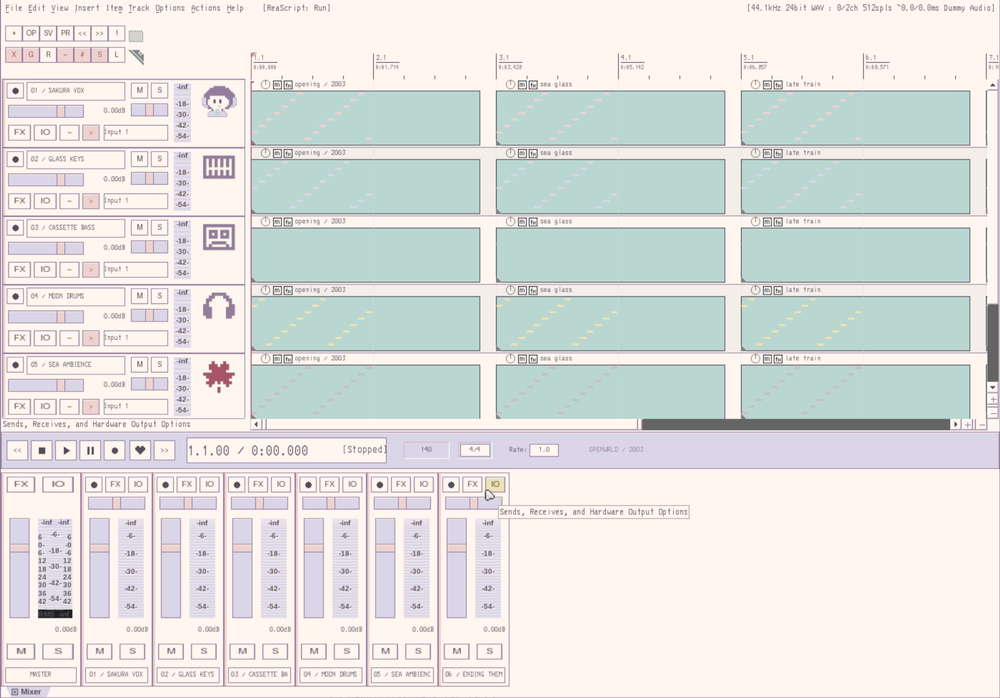

# tayowrld dots · seaside 2003

A warm, light desktop with seaside wallpaper, pixel icons, classic window borders, and a lilac Bash prompt.


## Installation

Run as your desktop user on an existing Linux installation:

```bash
git clone <your-repository-url> ~/.tayowrld-dots
cd ~/.tayowrld-dots
./install.sh --check
./install.sh
```

Requires Python 3, access to your distribution's package repositories, and sudo for package installation. Supports Arch Linux / Arch Linux ARM and non-Atomic Fedora / Fedora Asahi Remix on `x86_64` and `aarch64`. Other distributions and Atomic/OSTree systems are rejected before changes are made. The installer does not install Asahi itself or replace kernels, bootloaders, or drivers.

Log out after installation and select Sway. An existing SwayFX installation is preserved; the portable configuration does not require FX commands. Original effects are saved in `examples/swayfx-effects.conf`. Enable them through `~/.config/sway/local.conf` only if your build supports them: `animation_duration_ms` is not available in every SwayFX version.

```bash
./install.sh --no-packages     # dependencies are already installed
./install.sh --tools           # build here and tado using their Cargo.lock files
./install.sh --corners         # build the corner overlay; enabled in a new Asahi local.conf
./install.sh --xdg-only        # normalize standard XDG directory names only
```

`--tools` requires Rust with edition 2024 support and access to crates.io. Architecture-specific binaries are not bundled. Bash works without the optional `here` helper. `compress-web` requires a separately installed FFmpeg. Rust LSP support requires `rust-analyzer` and Neovim 0.11 or newer.

## REAPER · OPENWRLD / Seaside 2003

The normal installer now installs REAPER if missing and selects the bundled original
`OPENWRLD_Seaside_2003.ReaperThemeZip`. Existing REAPER versions are preserved.
Fresh installs use the official Linux 7.84 build for x86_64 or aarch64, with a pinned
SHA-256 from [Cockos](https://www.reaper.fm/download.php?hashes=1), under
`~/.local/opt/REAPER`. REAPER is proprietary; the installer does not supply a license.
The `--no-packages` flag skips downloading REAPER too and requires it to be installed.

To update only the studio (leave the rest of the desktop alone):

```bash
./install.sh --reaper-only
./install.sh --reaper-only --no-packages  # use an existing REAPER installation
```

Close the main REAPER instance before installing. Independent `-cfgfile` preview
instances are allowed. The installer merges only `lastthemefn5` in `reaper.ini`,
backs up the previous file, and preserves audio/MIDI settings, plugin paths, recent
projects, and licenses. REAPER-only mode assumes the desktop audio/GTK dependencies
are already installed; use the normal installer on a fresh desktop.

The studio uses the Sway/Waybar cream, lilac, dusty rose, sea-glass and ink palette,
3270 Nerd Font Mono, original pixel buttons and segmented meters, a cassette app
icon, and five track icons including an anime producer portrait. Linux native
menus and dialogs are styled through `libSwell-user.colortheme`. DPI remains under
REAPER/system control. Third-party plugin interfaces retain their own styling.

Start an empty eight-track session with **File → Project templates → OPENWRLD_2003**.
It has vocals, doubles, keys, bass, drums, lead, texture, and ending tracks at
140 BPM, without media or plugin dependencies. Existing sessions are untouched.
Track icons can also be assigned through the track icon menu under `OPENWRLD`.
The heart on the transport is the repeat/loop button.

Rebuild the theme with `python3 scripts/build_reaper_theme.py` (requires Pillow
only for rebuilding; normal installation uses the packaged archive). All theme
images, WALTER layout and pixel drawings are original and generated from this
source; no bundled Default theme assets are redistributed. Switch themes through
**Options → Themes**; restore `libSwell-user.colortheme` from the installation
backup to revert native menu styling, then restart REAPER.



## Updates and backups

```bash
cd ~/.tayowrld-dots
git pull --ff-only
./install.sh
```

Each run deploys the current checkout; the installer does not pull changes itself. Unchanged files are left alone. Before replacing a changed file, including local edits, it saves a copy under `~/.local/state/tayowrld-dots/backups/<timestamp>/`, retaining the full original path. `~/.config/sway/local.conf` is always preserved. The package manager shows its transaction and requests its normal confirmation. The installer does not run a full system upgrade.

Restore individual files by copying them from the backup to their original paths. File replacement is atomic per file, but the installation as a whole is not transactional: fix the cause of a failure and rerun the installer. Files removed from future repository versions are not automatically deleted from your system. Configuration is installed under HOME/XDG; `/etc/sway` and `/etc/xdg/waybar` are left untouched.

## Directories

| XDG directory | Fresh installation name |
| --- | --- |
| Desktop | `desk` |
| Documents | `docs` |
| Templates | `templates` |
| Public | `public` |
| Downloads | `internet` |
| Music | `music` |
| Pictures | `img` |
| Videos | `video` |
| Projects (custom key) | `work` |

Existing custom paths are preserved **exactly**, including trailing slashes, external storage paths, and disabled directories pointing to `$HOME`. Standard English directory names are renamed together with their contents, leaving a relative compatibility symlink at the old location. If the destination already exists or the source is a symlink, the installer preserves the existing setting without merging directories.

Moves are recorded in `~/.local/state/tayowrld-dots/directory-moves.jsonl`. Localized and other nonstandard names are treated as custom paths and preserved.

## Contents

- `config/sway`: keybindings, spiral layout, REAPER popup helper, notifications, wallpaper, and screenshots.
- `config/waybar`: the active Retro panel configuration.
- Alacritty, Fuzzel, Eza, Btop, Neovim, GTK 3/4, Kvantum, Qt6ct, KDE colors, desktop portals, and environment.d.
- `shell`: the user's Bash setup, with quoted argument handling in `cd`.
- `bin`: power menu, portable battery monitor, and screenshot wrapper.
- `tools`: source code for `here` and `tado`, without personal `.here` files, the TODO database, or compiled binaries.
- `share`: Seaside-Pixel, pxsor, and 3270 Nerd Font Mono.

Assets come from the existing desktop theme. Shell history, application accounts, browser profiles, SSH keys, and credentials are excluded.

## Hardware

Native display modes are used by default. On Apple Silicon, a new `local.conf` sets the built-in display scale to 1.5 and starts the UPower lid helper. The original MacBook and ultrawide settings are retained in `examples/original-macbook-outputs.conf` as an example; they are not applied automatically.

The lid helper assumes `eDP-1` and positions `HDMI-A-1`. Adjust the constants in `config/sway/utils/lid-upower.py` for different connector names.

To enable the compiled corner overlay after the initial installation, add this to `local.conf`:

```text
exec ~/.config/sway/utils/bottom-corners
```

`@HOME@` and `@CONFIG@` are template placeholders replaced during installation. Home and XDG paths containing whitespace or shell metacharacters are explicitly rejected.

## Validation

```bash
python3 -m unittest discover -s tests -v
./install.sh --check
sway -C -c ~/.config/sway/config
```

Tests cover repeat installation, backups of local edits, symlink target preservation, custom XDG paths, Documents migration with data, directory conflicts, and platform detection. The Sway configuration was validated locally on Asahi ARM with SwayFX. The `here`, `tado`, and corner-overlay sources were built locally. Full package installation on clean Fedora and x86_64 systems has not been tested.

Screenshots show the real desktop session with Alacritty and the user's Bash on a temporary workspace. Reproduce them with `python3 scripts/screenshots.py` inside a running Sway session with grim and Alacritty installed.

## Attribution

See [ATTRIBUTION.md](ATTRIBUTION.md) for resource provenance and retained licenses. No blanket license overrides third-party resource terms.

Fedora package references: [Qt6ct](https://packages.fedoraproject.org/pkgs/qt6ct/qt6ct/), [Kvantum](https://packages.fedoraproject.org/pkgs/kvantum/).
