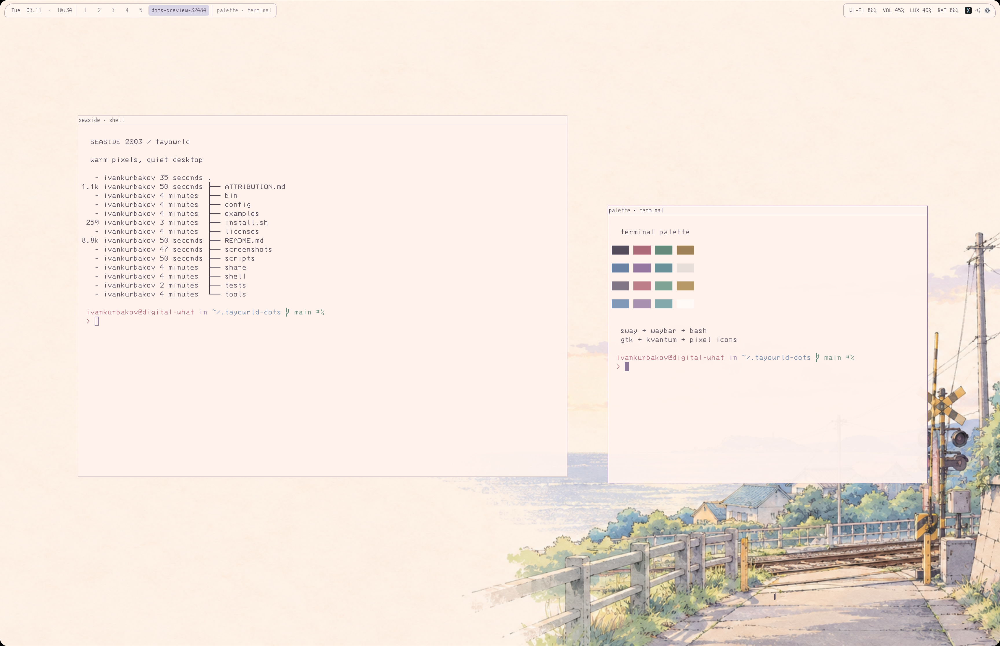
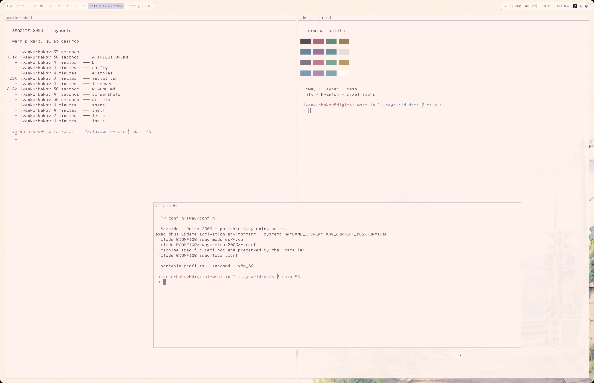

# tayowrld dots · seaside 2003

Тёплый светлый рабочий стол: море, пиксельные иконки, классические заголовки окон и сиреневый Bash prompt.




## Установка

На уже установленной Linux-системе, от обычного пользователя:

```bash
git clone <your-repository-url> ~/.tayowrld-dots
cd ~/.tayowrld-dots
./install.sh --check
./install.sh
```

Требуются Python 3, доступ к репозиториям дистрибутива и sudo для пакетов. Скрипт поддерживает Arch Linux / Arch Linux ARM и обычную Fedora / Fedora Asahi Remix на `x86_64` и `aarch64`. Atomic/OSTree и остальные дистрибутивы отклоняются до изменений. Сам Asahi, ядро, загрузчик и драйверы скрипт не устанавливает и не заменяет.

После установки выйдите из сеанса и выберите Sway. Уже установленный SwayFX сохраняется; переносимый профиль не требует FX-команд. В `examples/swayfx-effects.conf` сохранены настройки исходного сеанса; включайте их в `~/.config/sway/local.conf` только если ваша сборка их поддерживает. В исходной системе используется `animation_duration_ms`, доступный не во всех версиях SwayFX.

```bash
./install.sh --no-packages     # зависимости уже установлены
./install.sh --tools           # собрать here + tado из исходников, Cargo.lock фиксирует зависимости
./install.sh --corners         # собрать GTK overlay скруглений; включается в новом Asahi local.conf
./install.sh --xdg-only        # только нормализация XDG-каталогов
```

`--tools` требует современный Rust с edition 2024 и доступ к crates.io. Готовые ARM-бинарники не распространяются. `here` необязателен: Bash работает и без него. `compress-web` использует отдельно установленный FFmpeg. Rust LSP в Neovim требует `rust-analyzer` и Neovim 0.11+.

## Обновление и резервные копии

```bash
cd ~/.tayowrld-dots
git pull --ff-only
./install.sh
```

Повторный запуск разворачивает текущую версию checkout; сам установщик не делает `git pull`. Неизменившиеся файлы не трогает. Изменённые конфиги, включая локальные правки, сначала копирует в `~/.local/state/tayowrld-dots/backups/<timestamp>/` с полным деревом исходных путей, затем заменяет. `~/.config/sway/local.conf` сохраняется всегда. Пакетный менеджер показывает транзакцию и запрашивает обычное подтверждение; полного обновления ОС скрипт не запускает.

Для восстановления отдельного файла скопируйте его из backup на исходное место. Установка заменяет файлы атомарно по одному, но не является транзакцией целиком: при сбое исправьте причину и запустите снова. Старые файлы, отсутствующие в новой версии репозитория, автоматически не удаляются. Пользовательские конфиги размещаются в HOME/XDG; `/etc/sway` и `/etc/xdg/waybar` остаются нетронутыми.

## Каталоги

| XDG | Имя для новой установки |
| --- | --- |
| Desktop | `desk` |
| Documents | `docs` |
| Templates | `templates` |
| Public | `public` |
| Downloads | `internet` |
| Music | `music` |
| Pictures | `img` |
| Videos | `video` |
| Projects (пользовательский ключ) | `work` |

Уже настроенные нестандартные пути сохраняются **буквально**, включая `internet/`, `music/`, `img/`, `video/`, `work/`, внешние диски и отключённые каталоги (`$HOME`). Стандартные английские имена переименовываются с содержимым; на старом месте остаётся совместимая относительная ссылка. Если новое имя уже занято или старое является ссылкой, скрипт ничего не объединяет и сохраняет старую настройку. Журнал перемещений: `~/.local/state/tayowrld-dots/directory-moves.jsonl`. Локализованные и другие нестандартные названия считаются пользовательскими и сохраняются.

## Состав

- `config/sway`: клавиши, спиральная раскладка, REAPER popup helper, уведомления, обои, снимки экрана.
- `config/waybar`: активная панель Retro; неиспользуемая старая конфигурация Hyprland не включена.
- Alacritty, Fuzzel, Eza, Btop, Neovim, GTK 3/4, Kvantum, Qt6ct, KDE palette, portal и environment.d.
- `shell`: пользовательский Bash; исправлена обработка путей с пробелами в `cd`.
- `bin`: power menu, portable battery monitor, screenshot wrapper.
- `tools`: исходники `here` и `tado`, без персональных `.here`, TODO-базы и скомпилированных бинарников.
- `share`: Seaside-Pixel, pxsor и 3270 Nerd Font Mono.

Обои и интерфейсные ресурсы взяты из текущей пользовательской темы. Истории shell, аккаунты приложений, браузерные профили, SSH-ключи и credentials не включены.

## Оборудование

По умолчанию используются родные режимы выходов, без привязки к монитору автора. На Apple Silicon автоматически создаётся `local.conf` с масштабом встроенного экрана 1.5 и UPower lid helper. Исходные настройки MacBook + ultrawide сохранены в `examples/original-macbook-outputs.conf` как пример, не применяются автоматически. Lid helper рассчитан на `eDP-1` и позиционирование `HDMI-A-1`; для другой разводки измените константы в `config/sway/utils/lid-upower.py`.

Для включения overlay после первой установки добавьте в `local.conf`:

```text
exec ~/.config/sway/utils/bottom-corners
```

В репозитории пути `@HOME@` / `@CONFIG@` — шаблоны; установщик подставляет пути текущего пользователя. Домашние/XDG-пути с пробелами и метасимволами отклоняются явно.

## Проверка

```bash
python3 -m unittest discover -s tests -v
./install.sh --check
sway -C -c ~/.config/sway/config
```

Проверены повторная установка, backup локальных изменений, сохранение symlink-целей и пользовательских XDG, перенос Documents с данными и конфликт имён. Sway-конфиг проверен локально на Asahi ARM с SwayFX. Полная установка пакетов на чистых Fedora/x86_64 пока не проверена.

Снимки — реальный пользовательский сеанс, Alacritty и Bash, отдельный временный workspace. Воспроизвести: `python3 scripts/screenshots.py` (требует запущенный Sway, grim и Alacritty).

## Происхождение ресурсов

См. [ATTRIBUTION.md](ATTRIBUTION.md). Общая лицензия на сторонние ресурсы не переопределяется.

Проверка названий пакетов Fedora: [Qt6ct](https://packages.fedoraproject.org/pkgs/qt6ct/qt6ct/), [Kvantum](https://packages.fedoraproject.org/pkgs/kvantum/).
